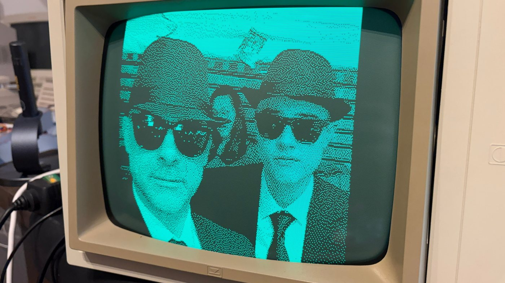
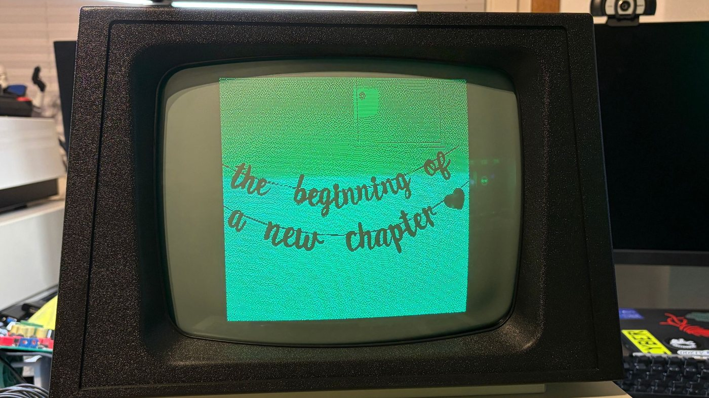
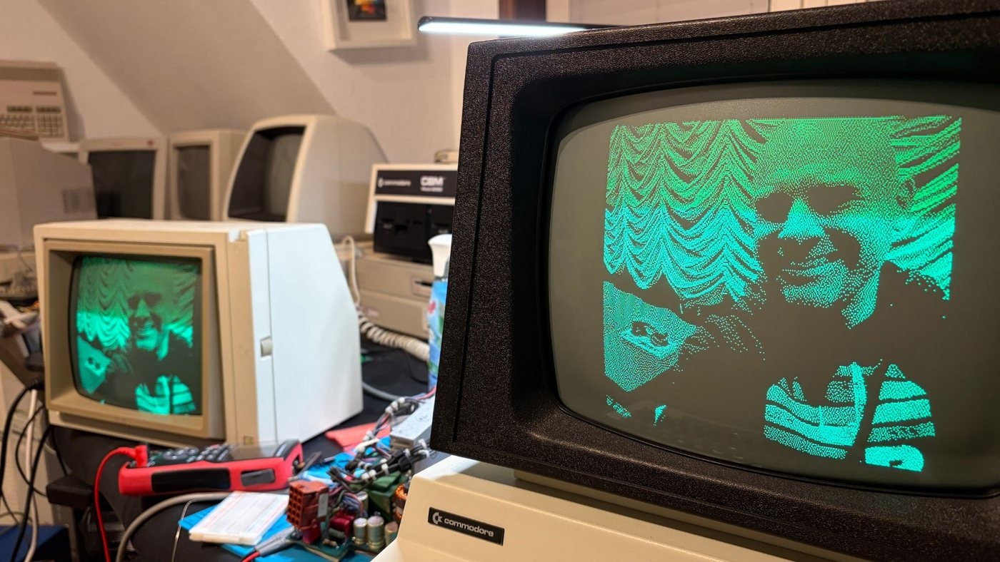
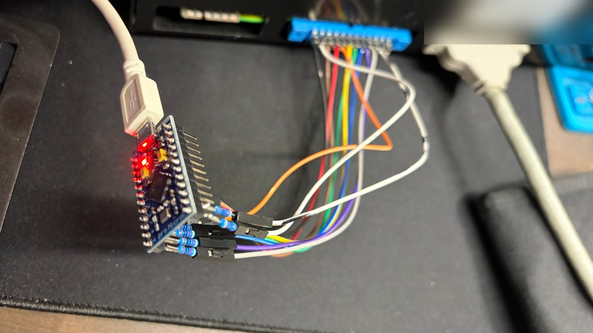
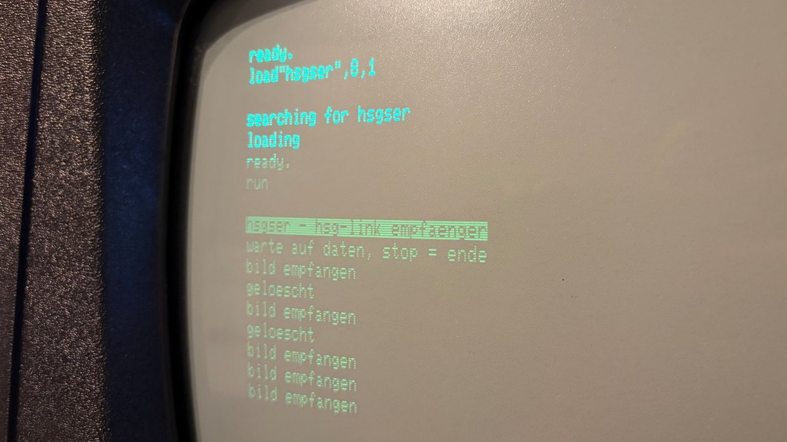
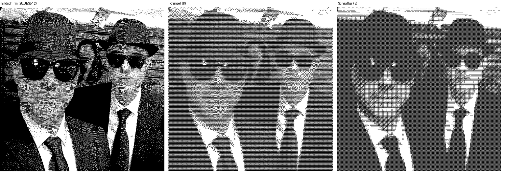
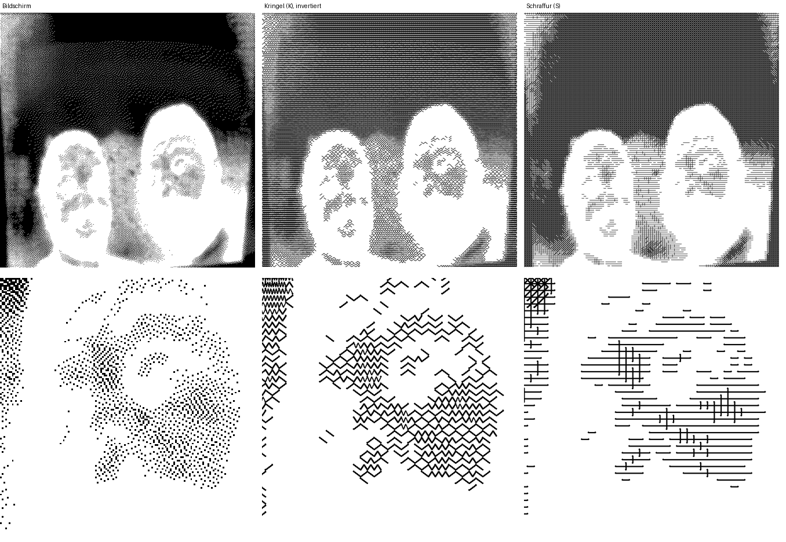
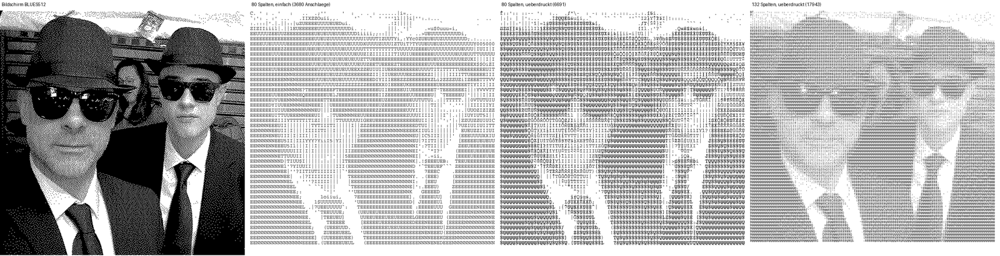
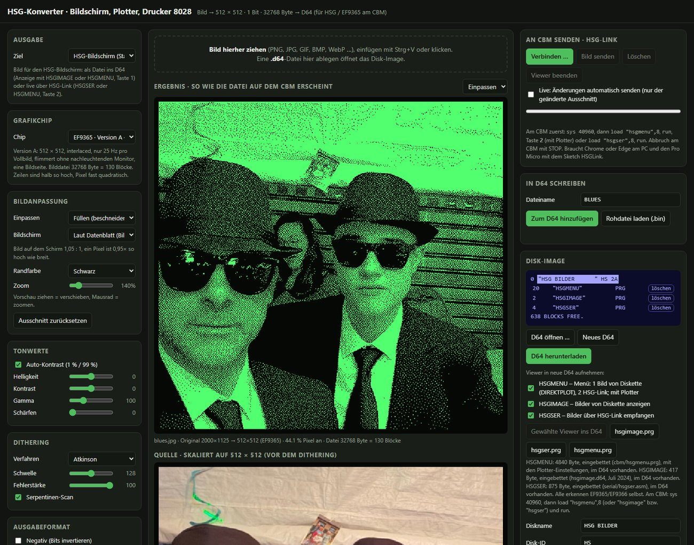

# CBM-HSG-Konverter

🇩🇪 [Deutsche Version](README.md) · 🇬🇧 English version

**Photos for the HSG/LSG graphics board in the Commodore CBM 8032/4032: display them, send them live from the PC, draw them on an HP plotter and print them on the CBM 8028 daisy-wheel printer.**

<p align="center">
  
</p>

Everything runs on the original CBM without modifying the computer. An HTML converter in the browser prepares the image, and a small 6502 program displays, receives and plots it. For live transfer you only need an Arduino Pro Micro and a home-made userport cable.

> **Language note:** The user interface of the converter and the messages on the CBM are in German. This page quotes them in the original with a translation, e.g. „Bild senden“ (*send image*). The Complete Guide is available in English; the detailed sub-documents (`cbm/README.md`, `serial/README.md`, the HSG-Link guide) are in German.

### How it started

It all began with the **[Low-Speed-Graphik (LSG)](https://github.com/InsaneDruid/Low-Speed-Graphik)** by **InsaneDruid**, a 100 % compatible replica of Commodore's HSG card for the CBM 8032, 4016 and 4032. It was built with help from the [VzEkC forum](https://forum.classic-computing.de/) community and is licensed CC BY-SA 4.0. The card came with two small programs that put the first picture on the screen:

- **`bmp2hsg.py`**, the original converter, also by **[InsaneDruid](https://github.com/InsaneDruid)** (Python, 2024, CC0). It turns a finished black-and-white BMP of 512 × 256 or 512 × 512 pixels into a loadable HSG file. It has no repository of its own. Its sister project for the Data Becker card is [BMP-2-DataPecker](https://github.com/InsaneDruid/BMP-2-DataPecker).
- The **HSG Image Loader** (HSGIMAGE) by **AndyG** (July 2024). It loads such a file from disk on the CBM and displays it.

Step by step this grew into the present project:
1. The Python script became an HTML converter that prepares any photo directly in the browser, with crop, tone controls, dithering and preview, and builds a D64 right away.
2. HSG-Link sends the images live via USB and the userport.
3. HSGMENU plots the image on an HP plotter, first dot by dot, now as hatching.
4. Last came the text graphics for the CBM 8028 daisy-wheel printer.

---

## Contents

- [What you need](#what-you-need)
- [Quick start](#quick-start)
- [Use case 1: Standalone on the CBM (disk)](#use-case-1-standalone-on-the-cbm-disk)
- [Use case 2: Serial – live images from the PC (HSG-Link)](#use-case-2-serial--live-images-from-the-pc-hsg-link)
- [Use case 3: Plotting on an HP plotter](#use-case-3-plotting-on-an-hp-plotter)
- [Use case 4: Printing on the CBM 8028](#use-case-4-printing-on-the-cbm-8028)
- [The HTML converter at a glance](#the-html-converter-at-a-glance)
- [Connectors on the CBM](#connectors-on-the-cbm)
- [Repository layout](#repository-layout)
- [Build and test](#build-and-test)
- [Technical details](#technical-details)
- [Status](#status)
- [Credits and sources](#credits-and-sources)
- [License](#license)

---

## What you need

| | Required | For |
|---|---|---|
| Commodore CBM 8032 or 4032 with **BASIC 4** and **32 KB RAM** | ✓ | |
| **HSG or LSG board** with EF9365 (512 × 512) or EF9366 (512 × 256) | ✓ | graphics |
| Drive on the IEEE-488 bus, e.g. an SD drive such as petSD+/[CBM-D9096](https://github.com/InsaneDruid/CBM-D9096) or a real 8050/8250 | ✓ | loading programs and images |
| PC with Chrome or Edge | ✓ | HTML converter |
| Arduino **Pro Micro 5 V / 16 MHz**, 10 × 470 Ω, userport edge connector 2 × 12 | | use case 2 |
| **HP plotter** with HP-GL on the IEEE bus (e.g. HP 7470A, 7475A) | | use case 3 |
| **CBM 8028 daisy-wheel printer** | | use case 4 |

## Quick start

> 📘 **Printable manual:** the **[Complete Guide (PDF, 17 pages)](CBM-HSG-Complete-Guide.pdf)** covering all use cases, key reference, troubleshooting and appendix ([German version](CBM-HSG-Komplett-Anleitung.pdf)). For building the HSG-Link cable there is also the **[HSG-Link guide](HSG-Link-Anleitung.pdf)** (German).

1. Open **[`hsg-converter.html`](hsg-converter.html)** in the browser and drop a photo onto it.
2. Top left, choose your board's chip under **„Grafikchip“** (*graphics chip*) and the target under **„Ausgabe“** (*output*).
3. Click **„D64 herunterladen“** (*download D64*) and copy the image to the SD card or a floppy. Or simply use the ready-made disk [`cbm/hsgmenu.d64`](cbm/hsgmenu.d64), which contains the program and test images.
4. On the CBM:

   ```
   sys 40960
   load "hsgmenu",8
   run
   ```

   ```
   HSGMENU - HSG-BOARD: BILDER ANZEIGEN UND PLOTTEN

   1 = NUR CBM (DIREKTPLOT): BILD VON DISKETTE LADEN
   2 = MIT SERIAL (HSG-LINK): BILDER VOM PC
   E = ENDE
   ```

   *1 = CBM only: load image from disk · 2 = serial: images from the PC · E = exit*

`sys 40960` activates the ROM of the HSG board.

---

## Use case 1: Standalone on the CBM (disk)

No cable to the PC: images are prepared on the PC, put on a disk and loaded on the CBM.

**On the PC**
1. Open [`hsg-converter.html`](hsg-converter.html), output **„HSG-Bildschirm“** (*HSG screen*).
2. Drop an image. Drag the crop with the mouse, zoom with the mouse wheel. Adjust tones and dithering. The preview shows exactly what will appear on the CBM.
3. Enter a file name on the right, click **„Zum D64 hinzufügen“** (*add to D64*), finally **„D64 herunterladen“**. HSGMENU and HSGIMAGE can be added to the disk as well.

**On the CBM**
1. `load "hsgmenu",8`, `run`, key **1**.
2. At `ENTER FILENAME ?` type the name, e.g. `BLUES512` (EF9365) or `BLUES256` (EF9366).
3. The program then asks `PLOTTEN? S=SCHRAFFUR K=KRINGEL P=PUNKTE N=NEIN` (*plot? S = hatching, K = zigzag, P = dots, N = no*). Without a plotter, **N** goes on to the next image. **RETURN alone** at the file name prompt returns to the menu.

Loading and display are the original code of the **HSG Image Loader by AndyG** (July 2024). HSGIMAGE on its own works the same way: `load "hsgimage",8`, `run`.

<p align="center">
  
  
</p>

Image format: raw data without header, 64 bytes per line, top line first, most significant bit = leftmost pixel. EF9365: 512 lines = 32,768 bytes (130 blocks), EF9366: 256 lines = 16,384 bytes (65 blocks).

---

## Use case 2: Serial – live images from the PC (HSG-Link)

The HTML converter sends the image via USB to a Pro Micro, which passes it in parallel to the CBM's userport. With **„Live“**, every change to crop or tones appears on the CBM after a moment. Only the changed rectangle is transferred.

```
Browser (hsg-converter.html, Web Serial)
   │ USB
   ▼
Arduino Pro Micro 5 V / 16 MHz  ── serial/HSGLink/HSGLink.ino
   │ 8 data + strobe + acknowledge + GND, 470 Ω each
   ▼
Userport CBM 8032 (VIA 6522)  →  HSGMENU (key 2) or HSGSER  →  HSG board
```

<p align="center">
  
  
</p>
<p align="center"><sub>Left: Pro Micro with the 470 Ω resistors, the cable plugged into the userport (blue), next to it the IEEE cable to the drive. Right: HSGSER on the CBM receiving images from the browser („bild empfangen“ = <i>image received</i>).</sub></p>

**Building the hardware**
- Parts, wiring table and soldering plan: [`serial/README.md`](serial/README.md) and [`serial/verdrahtung.html`](serial/verdrahtung.html) (printable).
- Step-by-step guide for cable, installation and first start: [`HSG-Link-Anleitung.pdf`](HSG-Link-Anleitung.pdf) (German).
- In short:
  - Userport contacts C–L = PA0–PA7, B = CA1 (strobe), M = CB2 (acknowledge), A/N = ground.
  - Every signal line gets 470 Ω.
  - **Leave the userport's 5 V unconnected**, the Pro Micro is powered via USB.

**Programming the Pro Micro:** In the Arduino IDE select the board „Arduino Leonardo“ and upload `serial/HSGLink/HSGLink.ino`. The serial monitor shows `HSGLINK 1.0`.

**Usage**
1. On the CBM: `load "hsgmenu",8`, `run`, key **2**. Alternatively the plain receiver: `load "hsgser",8`, `run`.
2. In the HTML converter, on the right: **„HSG-Link → Verbinden …“** (*connect*) and choose the Pro Micro. Then **„Bild senden“** (*send image*), or switch on **„Live“**.
3. On the CBM:
   - **D**/**SPACE** additionally shows the graphics on the built-in screen.
   - **S**, **K** or **H** plot the image currently displayed (see use case 3).
   - **STOP** returns to the menu.

Protocol and handshake: [`serial/README.md`](serial/README.md#protokoll).

---

## Use case 3: Plotting on an HP plotter

The displayed image is read back from the HSG board and sent as HP-GL over the IEEE bus to the plotter. The plotter is connected to the bus in addition to the drive, factory address 5.

<p align="center"></p>

| Key | Mode | How | Best for |
|---|---|---|---|
| **S** | **Hatching** („Schraffur“) | up to 4 line layers (— \| / \\) per 4 × 4 cell, the darker the more | **photos**, strong contrast. Confirmed on a real plotter |
| **K** | Zigzag („Kringel“) | one continuous zigzag line per band | very few pen lifts, looks flatter |
| **P** / **H** | Dots („Punkte“) | each run of dots as a stroke | line drawings |

By default the plotter draws the **dark** areas, so the paper looks like the screen.

**How to**
1. In the HTML converter choose output **„Plotter“**. On the right you can set:
   - the brightness of the hatching (four layers),
   - size, pen, plotter address, margins and inversion.

   The paper preview uses exactly the 6502 algorithm and shows how often the pen is lowered.
2. Click **„HSGMENU mit diesen Werten ins D64“** (*write HSGMENU with these values to the D64*). The settings are then stored in the program, no POKEs needed.
3. Display an image on the CBM:
   - Menu item 1, then press **S**, **K** or **P** at the question.
   - Or menu item 2, then key **S**, **K** or **H**.

   **STOP** cancels only the plot.

**Why not simply dot by dot?** A dithered photo consists almost entirely of single dots. The first test lowered the pen for every dot: 60,000 times for one image, painful for plotter and pen. Measured on the test photo FOTO512 in emulation:

| Mode | Pen lowered | Travel pen up | Drawing distance | 6502 time |
|---|---|---|---|---|
| Dots | 59,861 × | 65 m | 27 m | 419 s |
| Zigzag | 161 × | 1.5 m | 71 m | 189 s |
| **Hatching** | **1,902 ×** | **21 m** | **69 m** | **37 s** |

The 6502 time excludes waiting for the plotter.

**Settings** (addresses 1043–1056; the HTML converter writes them into the program, otherwise POKE them after `load`):

| Address | Meaning | Default |
|---|---|---|
| 1043 | IEEE address of the plotter | 5 |
| 1044 | secondary address | 0 |
| 1045 | plotter units per pixel (0.025 mm) | 14, about 179 × 179 mm |
| 1046/1047 | left margin, low/high | 1800 |
| 1048/1049 | bottom margin, low/high | 250 |
| 1050 | 1 = draw dark areas, 0 = light | 1 |
| 1051 | pen number | 1 |
| 1052 | dot mode: bridge gaps up to n dots | 0 |
| 1053–1056 | hatching: from how many dark dots (of 16) layer 1–4 is drawn, 17 = off | 2, 5, 8, 11 |

More on the modes, reading back and memory: [`cbm/README.md`](cbm/README.md) (German).

<p align="center"></p>

---

## Use case 4: Printing on the CBM 8028

The daisy-wheel printer cannot print graphics, only characters. So for each character cell the HTML converter picks the character or pair of characters whose shape best matches the image: text graphics in the best ASCII-art tradition, only with a real daisy wheel.

<p align="center"></p>

**How to**
1. In the HTML converter choose output **„Drucker CBM 8028“** (*printer*), then width (80, 96, 132 or 158 columns) and overstrike method.
2. **„Textgrafik ins D64“** (*text graphics to D64*), plus **„Druckprogramm DRUCK8028“** (*print program*) and **„Testseite 8028TEST“** (*test page*). Both are already on `cbm/hsgmenu.d64`.
3. Printer on the **IEEE bus**, address 4 (factory setting), switch **PRINT ON**.
4. On the CBM: `load "druck8028",8`, `run`, enter the file name, RETURN for address 4. Print **8028TEST** once first.

**8028 codes** (according to the operating manual, sections 8.3 and 9.1, daisy wheel RUSTIKA):

| Code | Effect |
|---|---|
| `$0D` CR | print line **with** line feed |
| `$8D` CS | print line **without** line feed, for overstriking (default) |
| `$08` BS | next character at the same position |
| `$04` / `$84` | 10 / 12 characters per inch, set by the file itself |
| `$41–$5A` / `$C1–$DA` | a–z / A–Z, the 8028 reads PETSCII |

Notes:
- Recognisable faces need 132 columns.
- A dark image uses a lot of ribbon.
- With **PRINT OFF** the 8028 blocks the bus as soon as it is addressed.

---

## The HTML converter at a glance

[`hsg-converter.html`](hsg-converter.html) is a **single HTML file**: download, double-click, done. No server, no installation, no internet connection. The browser does all the work on your own PC, no image leaves the computer. Only HSG-Link needs Chrome or Edge (Web Serial).

<p align="center"></p>

The page has three columns:

| Left: settings | Centre: preview | Right: output |
|---|---|---|
| Output target, graphics chip, image fitting, tones, dithering, output format | Drop an image. **Result** exactly as on the CBM, below it the **source** before dithering. Depending on the target, also the **plot** or **print preview** on paper | HSG-Link (send, live), plotter or 8028 settings, write to D64, disk image with a CBM-style directory |

The sections (German labels):

| Section | Functions |
|---|---|
| **Ausgabe** (*output*) | HSG screen · plotter · printer 8028; switches previews and panels |
| **Grafikchip** (*graphics chip*) | EF9366 (512 × 256) or EF9365 (512 × 512) |
| **Bildanpassung** (*image fitting*) | fill, fit or stretch. Aspect ratio per data sheet (image ≈ 1.05 : 1) or your own measurement. Zoom and crop with the mouse |
| **Tonwerte** (*tones*) | auto contrast, brightness, contrast, gamma, sharpen |
| **Dithering** | Floyd-Steinberg, **Atkinson** (default), Jarvis-Judice-Ninke, Bayer 4 × 4 / 8 × 8, threshold |
| **Ausgabeformat** (*output format*) | negative, bit order, line order, file type, load address |
| **HSG-Link** | connect, send image, live, clear, quit viewer |
| **Disk-Image** | open, create and save D64. View and delete files. Add HSGMENU, HSGIMAGE and HSGSER |

The browser remembers the settings and the current D64.

---

## Connectors on the CBM

<p align="center"></p>

Rear of the 8032-32 B, seen from behind:
- **Right, grey connector: IEEE-488.** Drive, plotter and printer are daisy-chained here.
- **Centre, blue connector: userport.** This is where the HSG-Link cable goes. Contact 1/A is on the left.
- **Left:** the cassette port.

Pinout details: [`serial/README.md`](serial/README.md#verdrahtung) (German).

> **Tip for IEEE bus problems:**
> - A device that is switched off can pull the bus lines low.
> - Two devices on the same address interfere with each other.
>
> If in doubt, connect one device after the other.

---

## Repository layout

```
hsg-converter.html        HTML converter: image preparation, HSG-Link, plot and 8028 preview, D64 management
CBM-HSG-Complete-Guide.pdf      complete guide (English): all use cases, keys, troubleshooting, appendix
CBM-HSG-Komplett-Anleitung.pdf  the same guide in German
HSG-Link-Anleitung.pdf    HSG-Link guide (German): cable, installation, first start
anleitung/                HTML sources of the guides; build both PDFs: node tools/build-komplett.js
cbm/                      CBM programs, disks, test images, emulation tests  → cbm/README.md
  hsgmenu.asm/.prg/.d64     main program with menu (disk, HSG-Link, plotter)
  hsgplot.*                 single program: HSG-Link + plotter
  direktplot.*              single program: disk + plotter
  hpgl-sim.js               plotter simulation and references (also used in the HTML converter)
serial/                   HSG-Link: receiver HSGSER, Pro Micro sketch, soldering plan  → serial/README.md
tools/                    6502 assembler and emulator, disk tool, tests, update-html.js
docs/bilder/              images for this page
```

---

## Build and test

Only **Node.js** is required (tested with Node 24), no further packages. Assembler, 6502 emulator and D64 tool are in `tools/`.

```
node tools/asm6502.js cbm/hsgmenu.asm cbm/hsgmenu.prg
node tools/update-html.js
node cbm/make-d64.js
```

The three commands:
1. **`asm6502.js`** assembles HSGMENU. The same works for HSGPLOT, DIREKTPLOT and `serial/hsgser.asm` with their names.
2. **`update-html.js`** embeds the new HSGMENU and `cbm/hpgl-sim.js` in the HTML converter.
3. **`make-d64.js`** builds `hsgmenu.d64`, `hsgplot.d64` and `direktplot.d64`.

The tests run in an emulated CBM: 6502, VIA, EF936x with read-back, disk drive and an HP-GL plotter on the IEEE bus. All plot modes are checked byte for byte against the references in `cbm/hpgl-sim.js`:

```
node cbm/test-menu-serial.js
node cbm/test-menu-disk.js
node cbm/test-hsgplot.js
node cbm/test-direktplot.js
node tools/test-hsgser.js
node tools/test-website.js
```

| Test | Result |
|---|---|
| HSGMENU serial | 46/46 |
| HSGMENU disk | 51/51 |
| HSGPLOT | 44/44 |
| DIREKTPLOT | 49/49 |
| HSGSER | 20/20 |
| HTML converter | 17/17 |

---

## Technical details

- **Reading back from the HSG board** the same way as the HSG ROM (`hcopy` $A656, `tstb` $A580):
  1. Clear bit 0 of the mode register `$AF00`.
  2. Set X/Y.
  3. Send EF936x command `$0F`.
  4. Read `$AF20` and invert it. That gives 8 pixels, bit 0 = left.
- **IEEE output** via the BASIC 4 routines `$F563` (OPEN) and `$F2E0` (CLOSE), logical file 124, like `hcopy`.
- **Hatching:**
  - Each 4 × 4 cell gets a level 0–4.
  - While reading, the levels go into a map at `$2000–$5FFF`, and the horizontal layer is drawn at the same time.
  - Then the vertical layer and both diagonals follow from the map.
  - Each stroke becomes `PUx,y;PDx,y;`. The lines run in a serpentine.
- **Zigzag:**
  - Each cell gets (dark dots / 2) zigzags.
  - Each band is one continuous line. The pen only lifts over empty cells.
- **EF9366:** Each line is used twice so the image has the same height as with the EF9365.
- **Memory:**
  - HSGMENU occupies `$0401–$16E6`, the buffers go up to `$1826`, the map `$2000–$5FFF`.
  - Hence 32 KB RAM are required.
- **Aspect ratio:**
  - According to the EF9365/66 data sheet the image on a 4:3 monitor is about 1.05 : 1.
  - An EF9366 pixel is about 1.9 times as high as wide.

---

## Status

| Part | On real hardware |
|---|---|
| HTML converter, images on disk, HSGIMAGE | ✓ |
| HSG-Link with HSGSER | ✓ |
| Plot with dots and zigzag | ✓ (first tests) |
| **Plot with hatching, inverted** | ✓ (DIREKTPLOT, 16 Nov 2026) |
| **HSGMENU** (combines everything) | ✓ (20 Nov 2026) |
| CBM 8028 printer | not yet, in progress |

---

## Credits and sources

- **InsaneDruid** for the **[Low-Speed-Graphik (LSG)](https://github.com/InsaneDruid/Low-Speed-Graphik)**, the replica of the HSG card, and for **`bmp2hsg.py`**, the original converter.
- **AndyG** for the **HSG Image Loader** (HSGIMAGE, July 2024). It is embedded in the HTML converter and forms the loading part of DIREKTPLOT and HSGMENU.
- The **HSG ROM** (`hcopy`, `tstb`) shows how to read back from the board.
- **[NODISKEMU](https://github.com/nils-eilers/NODISKEMU)** (Nils Eilers) and **[CBM-D9096](https://github.com/InsaneDruid/CBM-D9096)** (InsaneDruid) for the SD drive on the IEEE bus.
- The community at the **[VzEkC forum](https://forum.classic-computing.de/)** (German):
  - [mein CBM 8032 (No. 2) mit Commodore High Speed Graphik](https://forum.classic-computing.de/forum/index.php?thread%2F13063-mein-cbm-8032-no-2-mit-commodore-high-speed-graphik%2F=) – HSG board, replica
  - [„Auf den Schirm!“ – HPGL-Dateien via Data Becker Grafikkarte und HSG auf dem CBM ausgeben](https://forum.classic-computing.de/forum/index.php?thread/31968-auf-den-schirm-hpgl-dateien-via-data-becker-grafikkarte-und-hsg-auf-dem-cbm-ausg/&pageNo=3) – HP-GL on the HSG
  - [CBM 8028 Typenraddrucker: Service Manual und Bedienungshandbuch](https://forum.classic-computing.de/forum/index.php?thread%2F9647-cbm-8028-typenraddrucker-service-manual-und-bedienungshandbuch%2F=) – 8028 manuals
- [Martin's retro site: High Speed Graphic Card (HSG)](https://1mhz.de/forum/thread/819-high-speed-graphic-card-hsg/) with manual and data sheet
- CBM 8032 schematics: [zimmers.net](https://www.zimmers.net/anonftp/pub/cbm/schematics/computers/pet/8032/index.html)
- CBM 8028 service manual: [archive.org](https://archive.org/details/CBM8028ServiceManualDE)

The BLUES test image and the photos are by the author.

## License

[MIT](LICENSE) for the code and documentation of this repository, with the exceptions listed in [NOTICE.md](NOTICE.md).

**Excluded** is the **HSG Image Loader (HSGIMAGE)** by **AndyG** (July 2024). It was shared freely by its author, all rights remain with him. It is included unchanged in the HTML converter and on `serial/hsgser.d64` and `cbm/hsgplot.d64`, and its loading routines are the basis of DIREKTPLOT, HSGMENU and HSGSER.

The photos in `docs/bilder/` and the BLUES test image are by the author and are shown with the consent of the people pictured.
