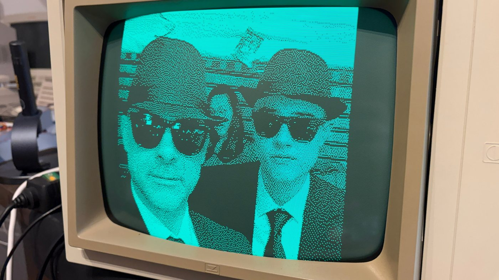
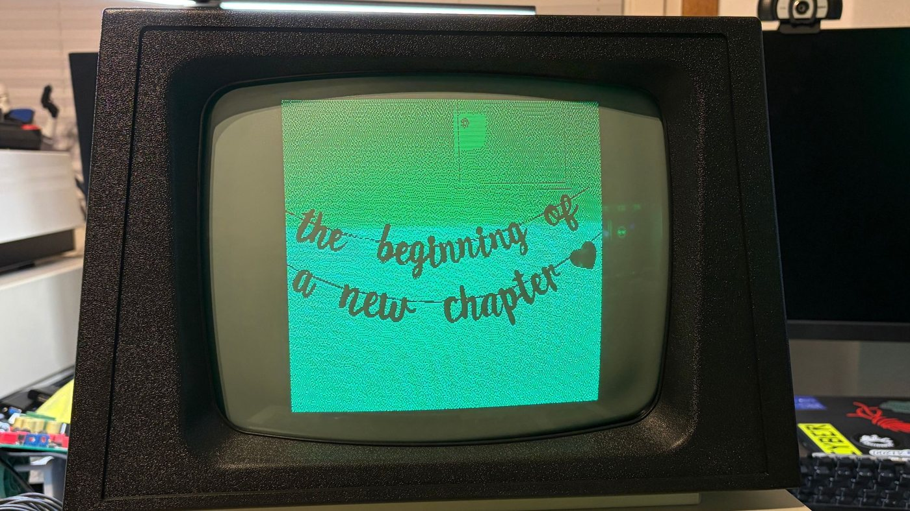
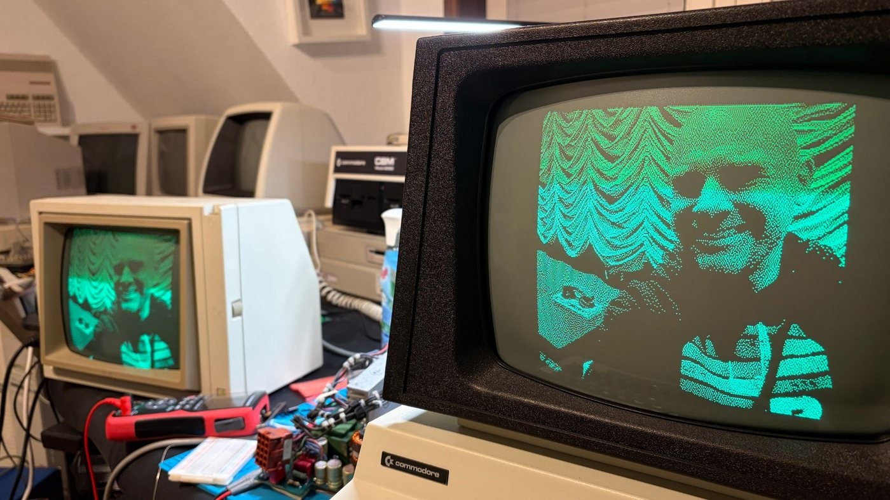
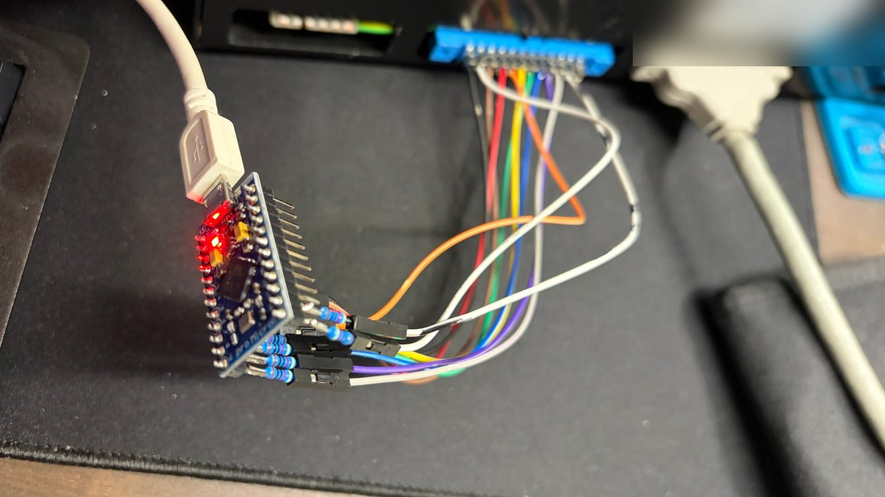
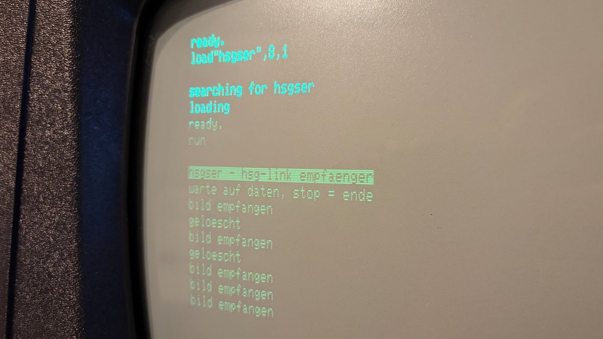
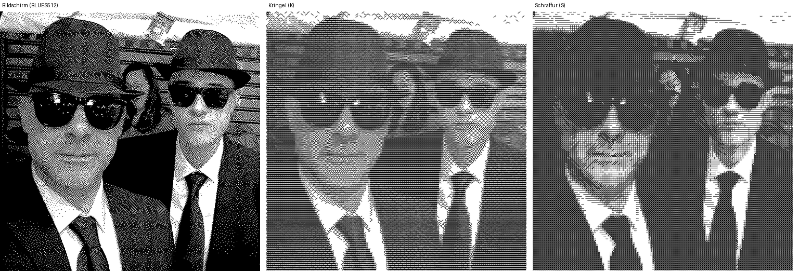
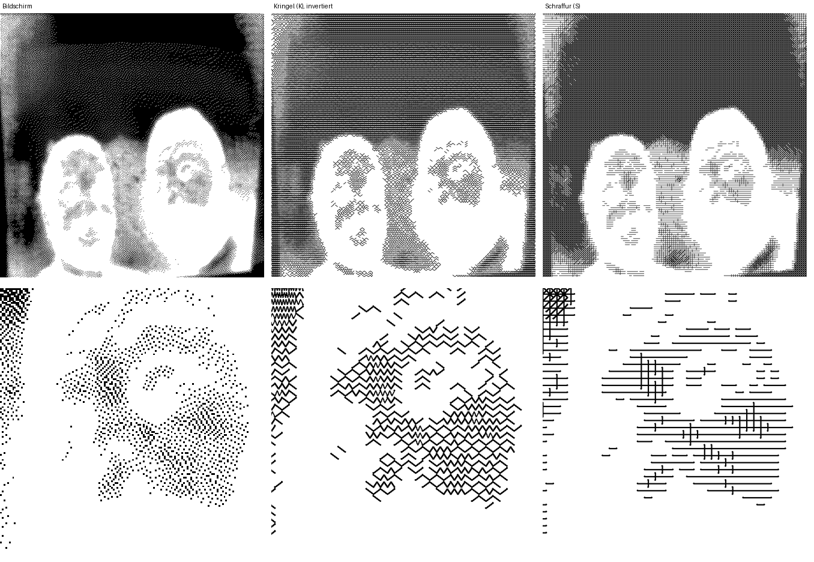
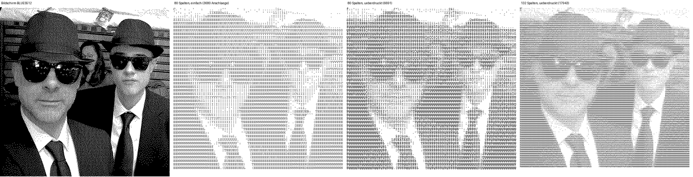
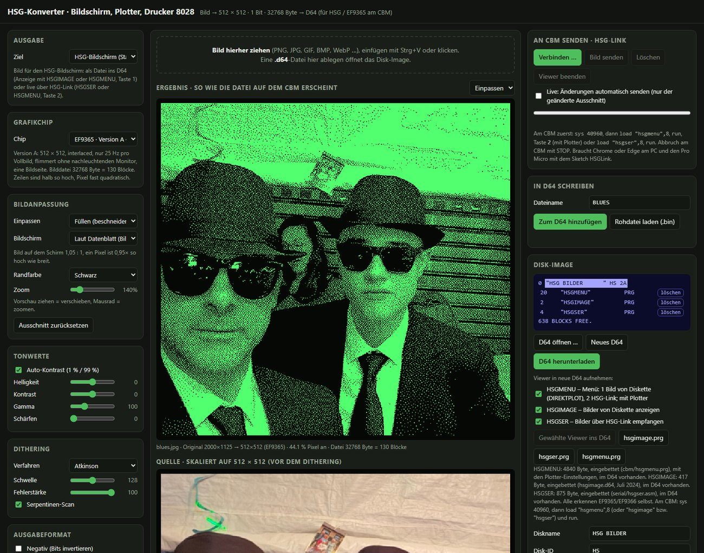

# CBM-HSG-Konverter

**Fotos für das HSG/LSG-Grafikboard im Commodore CBM 8032/4032: anzeigen, live vom PC senden, auf einem HP-Plotter zeichnen und auf dem Typenraddrucker CBM 8028 drucken.**

🇩🇪 Deutsche Version · 🇬🇧 [English version](README.en.md)

<p align="center">
  
</p>

Alles läuft auf dem Original-CBM, ohne Umbauten am Rechner: Ein HTML-Konverter im Browser bereitet das Bild auf, ein kleines 6502-Programm zeigt, empfängt und plottet. Für die Live-Übertragung braucht es nur einen Arduino Pro Micro und ein selbst gelötetes Userport-Kabel.

### Wie es dazu kam

Am Anfang stand die **[Low-Speed-Graphik (LSG)](https://github.com/InsaneDruid/Low-Speed-Graphik)** von **InsaneDruid**: ein zu 100 % kompatibler Nachbau der Commodore-HSG-Karte für CBM 8032, 4016 und 4032. Sie ist entstanden mit Hilfe der Runde im [VzEkC-Forum](https://forum.classic-computing.de/) und steht unter CC BY-SA 4.0. Mit der Karte kamen zwei kleine Programme, mit denen das erste Bild auf den Schirm kam:

- **`bmp2hsg.py`**, das Ur-Programm des Konverters, ebenfalls von **[InsaneDruid](https://github.com/InsaneDruid)** (Python, 2024, CC0). Es wandelt eine fertige Schwarz-Weiß-BMP mit 512 × 256 oder 512 × 512 Punkten in eine ladbare HSG-Datei. Ein eigenes Repository dafür gibt es nicht. Das Schwesterprojekt für die Data-Becker-Karte ist [BMP-2-DataPecker](https://github.com/InsaneDruid/BMP-2-DataPecker).
- Der **HSG Image Loader** (HSGIMAGE) von **AndyG** (Juli 2024). Er lädt eine solche Datei am CBM von Diskette und zeigt sie an.

Daraus wurde Schritt für Schritt dieses Projekt:
1. Aus dem Python-Skript wurde ein HTML-Konverter, der jedes Foto direkt im Browser aufbereitet, mit Ausschnitt, Tonwerten, Dithering und Vorschau, und gleich ein D64 baut.
2. HSG-Link schickt die Bilder live per USB über den Userport.
3. HSGMENU plottet das Bild auf einem HP-Plotter, zuerst Punkt für Punkt, inzwischen als Schraffur.
4. Zuletzt kam die Textgrafik für den Typenraddrucker CBM 8028 dazu.

---

## Inhalt

- [Was man braucht](#was-man-braucht)
- [Schnellstart](#schnellstart)
- [Anwendungsfall 1: Lokal am CBM (Diskette)](#anwendungsfall-1-lokal-am-cbm-diskette)
- [Anwendungsfall 2: Mit Serial – Bilder live vom PC (HSG-Link)](#anwendungsfall-2-mit-serial--bilder-live-vom-pc-hsg-link)
- [Anwendungsfall 3: Plotten auf einem HP-Plotter](#anwendungsfall-3-plotten-auf-einem-hp-plotter)
- [Anwendungsfall 4: Drucken auf dem CBM 8028](#anwendungsfall-4-drucken-auf-dem-cbm-8028)
- [Der HTML-Konverter im Überblick](#der-html-konverter-im-überblick)
- [Anschlüsse am CBM](#anschlüsse-am-cbm)
- [Aufbau des Repositorys](#aufbau-des-repositorys)
- [Bauen und testen](#bauen-und-testen)
- [Technische Details](#technische-details)
- [Stand](#stand)
- [Danksagung und Quellen](#danksagung-und-quellen)
- [Lizenz](#lizenz)

---

## Was man braucht

| | Pflicht | Wofür |
|---|---|---|
| Commodore CBM 8032 oder 4032 mit **BASIC 4** und **32 KByte RAM** | ✓ | |
| **HSG- oder LSG-Board** mit EF9365 (512 × 512) oder EF9366 (512 × 256) | ✓ | Grafik |
| Floppy am IEEE-488-Bus, z. B. ein SD-Laufwerk wie petSD+/[CBM-D9096](https://github.com/InsaneDruid/CBM-D9096) oder ein echtes 8050/8250 | ✓ | Programme und Bilder laden |
| PC mit Chrome oder Edge | ✓ | HTML-Konverter |
| Arduino **Pro Micro 5 V / 16 MHz**, 10 × 470 Ω, Userport-Stecker 2 × 12 | | Anwendungsfall 2 |
| **HP-Plotter** mit HP-GL am IEEE-Bus (z. B. HP 7470A, 7475A) | | Anwendungsfall 3 |
| **Typenraddrucker CBM 8028** | | Anwendungsfall 4 |

## Schnellstart

> 📘 **Alles zum Ausdrucken:** die **[Komplett-Anleitung (PDF, 16 Seiten)](CBM-HSG-Komplett-Anleitung.pdf)** mit allen Anwendungsfällen, Tastenübersicht, Fehlersuche und Anhang ([English: Complete Guide](CBM-HSG-Complete-Guide.pdf)). Für den Bau des HSG-Link-Kabels gibt es zusätzlich die **[HSG-Link-Anleitung](HSG-Link-Anleitung.pdf)**.

1. **[`hsg-converter.html`](hsg-converter.html)** im Browser öffnen und ein Foto hineinziehen.
2. Oben links bei **Grafikchip** den Chip deines Boards wählen und bei **Ausgabe** das Ziel.
3. **D64 herunterladen**, auf die SD-Karte bzw. Diskette bringen. Oder gleich die fertige Diskette [`cbm/hsgmenu.d64`](cbm/hsgmenu.d64) nehmen, darauf liegen Programm und Testbilder.
4. Am CBM:

   ```
   sys 40960
   load "hsgmenu",8
   run
   ```

   ```
   HSGMENU - HSG-BOARD: BILDER ANZEIGEN UND PLOTTEN

   1 = NUR CBM (DIREKTPLOT): BILD VON DISKETTE LADEN
   2 = MIT SERIAL (HSG-LINK): BILDER VOM PC
   E = ENDE
   ```

`sys 40960` aktiviert das ROM des HSG-Boards.

---

## Anwendungsfall 1: Lokal am CBM (Diskette)

Ohne Kabel zum PC: Bilder werden am PC vorbereitet, auf Diskette gebracht und am CBM geladen.

**Am PC**
1. [`hsg-converter.html`](hsg-converter.html) öffnen, Ausgabe **HSG-Bildschirm**.
2. Bild hineinziehen. Ausschnitt mit der Maus verschieben, mit dem Mausrad zoomen. Tonwerte und Dithering einstellen. Die Vorschau zeigt genau das, was später am CBM erscheint.
3. Rechts einen Dateinamen eingeben, **Zum D64 hinzufügen**, am Ende **D64 herunterladen**. HSGMENU und HSGIMAGE kommen auf Wunsch gleich mit auf die Diskette.

**Am CBM**
1. `load "hsgmenu",8`, `run`, Taste **1**.
2. Bei `ENTER FILENAME ?` den Namen eingeben, z. B. `BLUES512` (EF9365) oder `BLUES256` (EF9366).
3. Danach fragt das Programm `PLOTTEN? S=SCHRAFFUR K=KRINGEL P=PUNKTE N=NEIN`: Mit **N** geht es zum nächsten Bild, ohne Plotter ist hier Schluss. **Nur RETURN** beim Dateinamen führt zurück ins Menü.

Laden und Anzeigen ist der Originalcode des **HSG Image Loaders von AndyG** (Juli 2024). HSGIMAGE allein funktioniert genauso: `load "hsgimage",8`, `run`.

<p align="center">
  
  
</p>

Bildformat: Rohdaten ohne Kopf, 64 Byte je Zeile, oberste Zeile zuerst, höchstes Bit = linker Punkt. EF9365: 512 Zeilen = 32 768 Byte (130 Blöcke), EF9366: 256 Zeilen = 16 384 Byte (65 Blöcke).

---

## Anwendungsfall 2: Mit Serial – Bilder live vom PC (HSG-Link)

Der HTML-Konverter schickt das Bild über USB an einen Pro Micro, der es parallel an den Userport des CBM gibt. Mit **Live** erscheint jede Änderung an Ausschnitt oder Tonwerten nach einem Augenblick auf dem CBM, übertragen wird nur das geänderte Rechteck.

```
Browser (hsg-converter.html, Web Serial)
   │ USB
   ▼
Arduino Pro Micro 5 V / 16 MHz  ── serial/HSGLink/HSGLink.ino
   │ 8 Daten + Strobe + Quittung + GND, je 470 Ω
   ▼
Userport CBM 8032 (VIA 6522)  →  HSGMENU (Taste 2) oder HSGSER  →  HSG-Board
```

<p align="center">
  
  
</p>
<p align="center"><sub>Links: Pro Micro mit den 470-Ω-Widerständen, das Kabel steckt am User-Port (blau), rechts daneben das IEEE-Kabel zur Floppy. Rechts: HSGSER am CBM empfängt Bilder vom Browser.</sub></p>

**Hardware bauen**
- Teile, Verdrahtungstabelle und Lötplan: [`serial/README.md`](serial/README.md) und [`serial/verdrahtung.html`](serial/verdrahtung.html) (zum Ausdrucken).
- Schritt-für-Schritt-Anleitung für Kabel, Installation und Inbetriebnahme: [`HSG-Link-Anleitung.pdf`](HSG-Link-Anleitung.pdf).
- Kurzfassung:
  - Userport-Kontakte C–L = PA0–PA7, B = CA1 (Strobe), M = CB2 (Quittung), A/N = Masse.
  - Jede Signalleitung bekommt 470 Ω.
  - **Die 5 V des Userports bleiben frei**, der Pro Micro hängt am USB.

**Pro Micro programmieren:** In der Arduino-IDE das Board „Arduino Leonardo“ wählen und `serial/HSGLink/HSGLink.ino` hochladen. Im seriellen Monitor erscheint `HSGLINK 1.0`.

**Benutzung**
1. Am CBM `load "hsgmenu",8`, `run`, Taste **2**. Alternativ den reinen Empfänger `load "hsgser",8`, `run`.
2. Im HTML-Konverter rechts **HSG-Link → Verbinden …** und den Pro Micro wählen. Dann **Bild senden**, oder **Live** einschalten.
3. Am CBM:
   - **D**/**LEER** schaltet die Grafik zusätzlich auf den eingebauten Bildschirm.
   - **S**, **K** oder **H** plotten das gerade angezeigte Bild (siehe Anwendungsfall 3).
   - **STOP** führt zurück ins Menü.

Protokoll und Handshake: [`serial/README.md`](serial/README.md#protokoll).

---

## Anwendungsfall 3: Plotten auf einem HP-Plotter

Das angezeigte Bild wird vom HSG-Board zurückgelesen und als HP-GL über den IEEE-Bus an den Plotter geschickt. Der Plotter hängt zusätzlich zur Floppy am Bus, ab Werk auf Adresse 5.

<p align="center"></p>

| Taste | Modus | Wie | Wofür |
|---|---|---|---|
| **S** | **Schraffur** | bis zu 4 Linienlagen (— \| / \\) je 4 × 4-Fläche, je dunkler, desto mehr | **Fotos**, kräftige Kontraste. Am echten Plotter bestätigt |
| **K** | Kringel | eine durchgehende Zickzacklinie je Band | sehr wenig Stiftabsetzen, wirkt flauer |
| **P** / **H** | Punkte | jede Punktfolge als Strich | Strichzeichnungen |

Der Plotter zeichnet ab Werk die **dunklen** Stellen, das Papier sieht also aus wie der Bildschirm.

**So geht's**
1. Im HTML-Konverter die Ausgabe **Plotter** wählen. Rechts lassen sich einstellen:
   - die Helligkeit der Schraffur (vier Lagen),
   - Größe, Stift, Plotter-Adresse, Ränder und Invertierung.

   Die Papiervorschau rechnet mit genau dem Verfahren des 6502 und zeigt, wie oft der Stift absetzt.
2. **HSGMENU mit diesen Werten ins D64**: Die Einstellungen stehen dann fest im Programm, POKEs sind nicht nötig.
3. Am CBM ein Bild anzeigen:
   - Menüpunkt 1, dann bei der Frage **S**, **K** oder **P** drücken.
   - Oder Menüpunkt 2, dann Taste **S**, **K** oder **H**.

   **STOP** bricht nur den Plot ab.

**Warum nicht einfach Punkt für Punkt?** Ein gedithertes Foto besteht fast nur aus Einzelpunkten. Der erste Test hat den Stift für jeden Punkt abgesetzt: 60 000-mal für ein Bild, quälend für Plotter und Stift. Gemessen am Foto-Testbild FOTO512 in der Emulation:

| Modus | Stift senken | Leerfahrt | Zeichenweg | Rechenzeit 6502 |
|---|---|---|---|---|
| Punkte | 59 861 × | 65 m | 27 m | 419 s |
| Kringel | 161 × | 1,5 m | 71 m | 189 s |
| **Schraffur** | **1 902 ×** | **21 m** | **69 m** | **37 s** |

Die Rechenzeit gilt ohne die Wartezeit auf den Plotter.

**Einstellungen** (Adressen 1043–1056; der HTML-Konverter schreibt sie ins Programm, sonst per POKE nach dem `load`):

| Adresse | Bedeutung | Vorgabe |
|---|---|---|
| 1043 | IEEE-Adresse des Plotters | 5 |
| 1044 | Sekundäradresse | 0 |
| 1045 | Plotter-Einheiten je Bildpunkt (0,025 mm) | 14, ergibt ca. 179 × 179 mm |
| 1046/1047 | linker Rand, Low/High | 1800 |
| 1048/1049 | unterer Rand, Low/High | 250 |
| 1050 | 1 = dunkle Stellen zeichnen, 0 = helle | 1 |
| 1051 | Stift-Nummer | 1 |
| 1052 | Punkte-Modus: Lücken bis n Punkte mitzeichnen | 0 |
| 1053–1056 | Schraffur: ab wie vielen dunklen Punkten (von 16) Lage 1–4 kommt, 17 = aus | 2, 5, 8, 11 |

Mehr zu den Modi, zum Zurücklesen und zum Speicher: [`cbm/README.md`](cbm/README.md).

<p align="center"></p>

---

## Anwendungsfall 4: Drucken auf dem CBM 8028

Der Typenraddrucker kann keine Grafik, nur Zeichen. Der HTML-Konverter wählt daher je Zeichenzelle das Zeichen oder Zeichenpaar, dessen Form am besten zum Bild passt: eine Textgrafik in bester ASCII-Art-Tradition, nur mit echtem Typenrad.

<p align="center"></p>

**So geht's**
1. Im HTML-Konverter die Ausgabe **Drucker CBM 8028** wählen, dann Breite (80, 96, 132 oder 158 Zeichen) und Art des Überdruckens.
2. **Textgrafik ins D64**, dazu **Druckprogramm DRUCK8028** und **Testseite 8028TEST**. Auf `cbm/hsgmenu.d64` sind beide schon drauf.
3. Drucker an den **IEEE-Bus**, Adresse 4 (ab Werk), Schalter **PRINT ON**.
4. Am CBM: `load "druck8028",8`, `run`, Dateiname eingeben, RETURN für Adresse 4. Vorher einmal **8028TEST** drucken.

**Codes des 8028** (laut Bedienungshandbuch, Abschnitte 8.3 und 9.1, Typenrad RUSTIKA):

| Code | Wirkung |
|---|---|
| `$0D` CR | Zeile drucken **mit** Zeilenvorschub |
| `$8D` CS | Zeile drucken **ohne** Zeilenvorschub, zum Überdrucken (Vorgabe) |
| `$08` BS | nächstes Zeichen auf dieselbe Stelle |
| `$04` / `$84` | 10 / 12 Zeichen pro Zoll, setzt die Datei selbst |
| `$41–$5A` / `$C1–$DA` | a–z / A–Z, der 8028 liest PETSCII |

Hinweise:
- Erkennbare Gesichter gibt es ab 132 Zeichen Breite.
- Ein dunkles Bild braucht viel Farbband.
- Bei **PRINT OFF** blockiert der 8028 den Bus, sobald er angesprochen wird.

---

## Der HTML-Konverter im Überblick

[`hsg-converter.html`](hsg-converter.html) ist eine **einzelne HTML-Datei**: herunterladen, doppelklicken, fertig. Es gibt keinen Server, keine Installation und keine Internetverbindung. Alles rechnet der Browser auf dem eigenen PC, kein Bild verlässt den Rechner. Nur für HSG-Link braucht es Chrome oder Edge (Web Serial).

<p align="center"></p>

Die Seite hat drei Spalten:

| Links: Einstellungen | Mitte: Vorschau | Rechts: Ausgabe |
|---|---|---|
| Ausgabe-Ziel, Grafikchip, Bildanpassung, Tonwerte, Dithering, Ausgabeformat | Bild hineinziehen. **Ergebnis** genau so, wie es am CBM erscheint, darunter die **Quelle** vor dem Dithering. Je nach Ziel zusätzlich die **Plot-** oder **Druckvorschau** auf Papier | HSG-Link (senden, live), Plotter- bzw. 8028-Einstellungen, D64 schreiben, Disk-Image mit Verzeichnis im CBM-Stil |

Die einzelnen Bereiche:

| Bereich | Funktionen |
|---|---|
| **Ausgabe** | HSG-Bildschirm · Plotter · Drucker 8028; schaltet Vorschauen und Karten um |
| **Grafikchip** | EF9366 (512 × 256) oder EF9365 (512 × 512) |
| **Bildanpassung** | Füllen, ganz zeigen oder strecken. Seitenverhältnis laut Datenblatt (Bild ≈ 1,05 : 1) oder eigene Messung. Zoom und Ausschnitt per Maus |
| **Tonwerte** | Auto-Kontrast, Helligkeit, Kontrast, Gamma, Schärfen |
| **Dithering** | Floyd-Steinberg, **Atkinson** (Vorgabe), Jarvis-Judice-Ninke, Bayer 4 × 4 / 8 × 8, Schwelle |
| **Ausgabeformat** | Negativ, Bitfolge, Zeilenrichtung, Dateityp, Ladeadresse |
| **HSG-Link** | Verbinden, Bild senden, Live, Löschen, Viewer beenden |
| **Disk-Image** | D64 öffnen, neu anlegen und speichern. Dateien ansehen und löschen. HSGMENU, HSGIMAGE und HSGSER einfügen |

Einstellungen und das aktuelle D64 merkt sich der Browser.

---

## Anschlüsse am CBM

<p align="center"></p>

Rückseite des 8032-32 B, von hinten gesehen:
- **Rechts, grauer Stecker: IEEE-488.** Hier hängen Floppy, Plotter und Drucker hintereinander.
- **Mitte, blauer Stecker: User-Port.** Hier steckt das HSG-Link-Kabel. Kontakt 1/A liegt links.
- **Links:** die Kassettenschnittstelle.

Details zur Belegung: [`serial/README.md`](serial/README.md#verdrahtung).

> **Tipp bei Problemen am IEEE-Bus:**
> - Ein ausgeschaltetes Gerät am Bus kann die Leitungen nach unten ziehen.
> - Zwei Geräte auf derselben Adresse stören sich.
>
> Im Zweifel ein Gerät nach dem anderen anschließen.

---

## Aufbau des Repositorys

```
hsg-converter.html        HTML-Konverter: Bildaufbereitung, HSG-Link, Plot- und 8028-Vorschau, D64-Verwaltung
CBM-HSG-Komplett-Anleitung.pdf  Komplett-Anleitung: alle Anwendungsfälle, Tasten, Fehlersuche, Anhang
CBM-HSG-Complete-Guide.pdf      dieselbe Anleitung auf Englisch
HSG-Link-Anleitung.pdf    Anleitung HSG-Link (Kabel, Installation, Inbetriebnahme)
anleitung/                HTML-Quellen der Anleitungen; beide PDFs bauen: node tools/build-komplett.js
cbm/                      CBM-Programme, Disketten, Testbilder, Emulationstests  → cbm/README.md
  hsgmenu.asm/.prg/.d64     Hauptprogramm mit Menü (Diskette, HSG-Link, Plotter)
  hsgplot.*                 Einzelprogramm: HSG-Link + Plotter
  direktplot.*              Einzelprogramm: Diskette + Plotter
  hpgl-sim.js               Plotter-Simulation und Referenzen (auch im HTML-Konverter)
serial/                   HSG-Link: Empfänger HSGSER, Pro-Micro-Sketch, Lötplan  → serial/README.md
tools/                    6502-Assembler und -Emulator, Disk-Werkzeug, Tests, update-html.js
docs/bilder/              Bilder für diese Seite
```

---

## Bauen und testen

Es wird nur **Node.js** gebraucht (getestet mit Node 24), ohne weitere Pakete. Assembler, 6502-Emulator und D64-Werkzeug liegen in `tools/`.

```
node tools/asm6502.js cbm/hsgmenu.asm cbm/hsgmenu.prg
node tools/update-html.js
node cbm/make-d64.js
```

Die drei Befehle:
1. **`asm6502.js`** assembliert HSGMENU. Für HSGPLOT, DIREKTPLOT und `serial/hsgser.asm` gilt dasselbe mit dem jeweiligen Namen.
2. **`update-html.js`** bettet das neue HSGMENU und `cbm/hpgl-sim.js` in den HTML-Konverter ein.
3. **`make-d64.js`** baut `hsgmenu.d64`, `hsgplot.d64` und `direktplot.d64`.

Die Tests laufen in einem emulierten CBM. Dazu gehören 6502, VIA, EF936x mit Rücklesen, Diskette und ein HP-GL-Plotter am IEEE-Bus. Alle Plot-Modi werden Byte für Byte gegen die Referenzen in `cbm/hpgl-sim.js` geprüft:

```
node cbm/test-menu-serial.js
node cbm/test-menu-disk.js
node cbm/test-hsgplot.js
node cbm/test-direktplot.js
node tools/test-hsgser.js
node tools/test-website.js
```

| Test | Ergebnis |
|---|---|
| HSGMENU Serial | 46/46 |
| HSGMENU Diskette | 51/51 |
| HSGPLOT | 44/44 |
| DIREKTPLOT | 49/49 |
| HSGSER | 20/20 |
| HTML-Konverter | 17/17 |

---

## Technische Details

- **Zurücklesen vom HSG-Board** wie das HSG-ROM (`hcopy` $A656, `tstb` $A580):
  1. Modusregister `$AF00` Bit 0 auf 0 setzen.
  2. X/Y setzen.
  3. EF936x-Befehl `$0F` schicken.
  4. `$AF20` lesen und invertieren. Das ergibt 8 Punkte, Bit 0 = links.
- **IEEE-Ausgabe** über die BASIC-4-Routinen `$F563` (OPEN) und `$F2E0` (CLOSE), logische Datei 124, wie `hcopy`.
- **Schraffur:**
  - Je 4 × 4-Fläche wird eine Stufe 0–4 bestimmt.
  - Die Stufen kommen beim Einlesen in eine Karte bei `$2000–$5FFF`. Gleichzeitig wird schon die waagerechte Lage gezeichnet.
  - Danach folgen die senkrechte Lage und die beiden Diagonalen aus der Karte.
  - Jede Strecke wird zu `PUx,y;PDx,y;`. Die Linien laufen in Schlangenlinie.
- **Kringel:**
  - Je Zelle gibt es (dunkle Punkte / 2) Zacken.
  - Jedes Band ist eine durchgehende Linie. Der Stift hebt nur über leeren Zellen ab.
- **EF9366:** Jede Zeile wird doppelt verwendet, damit das Bild gleich hoch wird wie beim EF9365.
- **Speicher:**
  - HSGMENU belegt `$0401–$16E6`, die Puffer reichen bis `$1826`, die Karte `$2000–$5FFF`.
  - Deshalb sind 32 KByte RAM nötig.
- **Seitenverhältnis:**
  - Laut Datenblatt EF9365/66 ist das Bild am 4:3-Monitor etwa 1,05 : 1.
  - Ein Pixel des EF9366 ist etwa 1,9-mal so hoch wie breit.

---

## Stand

| Teil | Am echten Gerät |
|---|---|
| HTML-Konverter, Bilder auf Diskette, HSGIMAGE | ✓ |
| HSG-Link mit HSGSER | ✓ |
| Plot mit Punkten und Kringeln | ✓ (erste Tests) |
| **Plot mit Schraffur, invertiert** | ✓ (DIREKTPLOT, 16.11.2026) |
| **HSGMENU** (fasst alles zusammen) | ✓ (20.11.2026) |
| Drucker CBM 8028 | noch nicht, in Arbeit |

---

## Danksagung und Quellen

- **InsaneDruid** für die **[Low-Speed-Graphik (LSG)](https://github.com/InsaneDruid/Low-Speed-Graphik)**, den Nachbau der HSG-Karte, und für **`bmp2hsg.py`**, das Ur-Programm des Konverters.
- **AndyG** für den **HSG Image Loader** (HSGIMAGE, Juli 2024). Er ist im HTML-Konverter eingebettet und bildet den Lade-Teil von DIREKTPLOT und HSGMENU.
- Das **HSG-ROM** (`hcopy`, `tstb`) zeigt, wie man vom Board zurückliest.
- **[NODISKEMU](https://github.com/nils-eilers/NODISKEMU)** (Nils Eilers) und **[CBM-D9096](https://github.com/InsaneDruid/CBM-D9096)** (InsaneDruid) für das SD-Laufwerk am IEEE-Bus.
- Die Runde im **[VzEkC-Forum](https://forum.classic-computing.de/)**:
  - [mein CBM 8032 (No. 2) mit Commodore High Speed Graphik](https://forum.classic-computing.de/forum/index.php?thread%2F13063-mein-cbm-8032-no-2-mit-commodore-high-speed-graphik%2F=) – HSG-Board, Nachbau
  - [„Auf den Schirm!“ – HPGL-Dateien via Data Becker Grafikkarte und HSG auf dem CBM ausgeben](https://forum.classic-computing.de/forum/index.php?thread/31968-auf-den-schirm-hpgl-dateien-via-data-becker-grafikkarte-und-hsg-auf-dem-cbm-ausg/&pageNo=3)
  - [CBM 8028 Typenraddrucker: Service Manual und Bedienungshandbuch](https://forum.classic-computing.de/forum/index.php?thread%2F9647-cbm-8028-typenraddrucker-service-manual-und-bedienungshandbuch%2F=)
- [Martins Retro-Seite: High Speed Graphic Card (HSG)](https://1mhz.de/forum/thread/819-high-speed-graphic-card-hsg/) mit Handbuch und Datenblatt
- Schaltpläne CBM 8032: [zimmers.net](https://www.zimmers.net/anonftp/pub/cbm/schematics/computers/pet/8032/index.html)
- CBM 8028 Service-Manual: [archive.org](https://archive.org/details/CBM8028ServiceManualDE)

Das Testbild BLUES und die Fotos stammen vom Autor.

## Lizenz

[MIT](LICENSE) für den Code und die Dokumentation dieses Repositorys, mit den in [NOTICE.md](NOTICE.md) genannten Ausnahmen.

**Ausgenommen** ist der **HSG Image Loader (HSGIMAGE)** von **AndyG** (Juli 2024). Er wurde von seinem Autor frei geteilt, alle Rechte bleiben bei ihm. Er steckt unverändert im HTML-Konverter sowie auf `serial/hsgser.d64` und `cbm/hsgplot.d64`, und seine Laderoutinen sind die Grundlage von DIREKTPLOT, HSGMENU und HSGSER.

Die Fotos in `docs/bilder/` und das Testbild BLUES stammen vom Autor und werden mit Einverständnis der Abgebildeten gezeigt.
