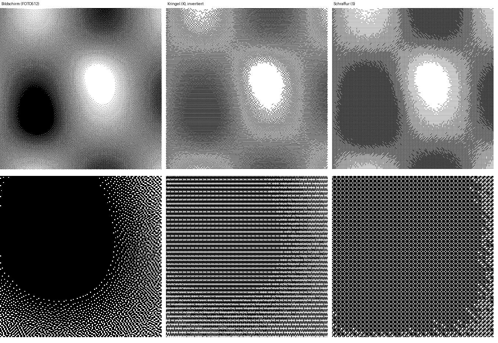

# CBM-Programme: HSGMENU, HSGPLOT, DIREKTPLOT

**HSGMENU** ist das Hauptprogramm. Es zeigt Bilder von Diskette oder vom PC an und gibt sie auf einen HP-Plotter aus, alles über ein Menü.
HSGPLOT (nur HSG-Link) und DIREKTPLOT (nur Diskette, früher HSGIMGPLOT) bleiben als Einzelprogramme. Ihr Code steckt auch in HSGMENU.

Die Website `../hsg-converter.html` (Ausgabe „Plotter“) schreibt HSGMENU mit den eingestellten Werten ins D64. POKEs sind dann nicht nötig.



## HSGMENU – Bedienung

```
sys 40960
load "hsgmenu",8
run
```

```
HSGMENU - HSG-BOARD: BILDER ANZEIGEN UND PLOTTEN

1 = NUR CBM (DIREKTPLOT): BILD VON DISKETTE LADEN
2 = MIT SERIAL (HSG-LINK): BILDER VOM PC
E = ENDE

WAHL ?
```

**1 – nur CBM (Bild von Diskette):**
1. Bei `ENTER FILENAME ?` den Namen eingeben, z. B. `BLUES512` (EF9365) oder `BLUES256` (EF9366). Laden und Anzeige sind der Originalcode von HSGIMAGE (AndyG, Juli 2024).
2. Danach kommt die Frage `PLOTTEN? S=SCHRAFFUR K=KRINGEL P=PUNKTE N=NEIN`:
   - **S**, **K**, **P** (oder **J**) plotten. Danach kommt die Frage noch einmal.
   - **N**, eine andere Taste oder **STOP** geht zum nächsten Dateinamen.
3. Bei `ENTER FILENAME ?` nur **RETURN** drücken, das führt zurück ins Menü.

**2 – mit Serial (HSG-Link):**
- Bilder kommen wie bei HSGSER vom Konverter im Browser.
- **S**, **K** oder **H** plotten das angezeigte Bild. Während einer Übertragung gedrückt, startet der Plot, sobald das Bild fertig ist.
- **D** oder **LEER** schaltet die Grafik auf dem CBM-Schirm an und aus.
- **STOP** oder „Viewer beenden“ im Konverter führt zurück ins Menü.

**Während eines Plots** bricht **STOP** nur den Plot ab, der Stift wird abgelegt.

**Im Menü** beenden **E** oder **STOP** das Programm.

**Einzelprogramme:**
- `load "hsgplot",8`: wie Menüpunkt 2. STOP beendet das Programm.
- `load "direktplot",8`: wie Menüpunkt 1. N beendet das Programm.

## Plot-Modi

| Taste | Modus | Wofür |
|---|---|---|
| **S** | Schraffur: bis zu 4 Linienlagen (— \| / \\) je 4 × 4-Fläche | Fotos, erste Wahl; am echten Plotter bestätigt |
| **K** | Kringel: eine Zickzacklinie je Band | sehr wenig Stiftabsetzen, aber flauer |
| **P** / **H** | Punkte: jede Punktfolge als Strich | Strichzeichnungen |

Ab Werk zeichnet der Plotter die dunklen Stellen, das Papier sieht also aus wie der Bildschirm.

Stiftbewegung am Foto-Testbild FOTO512 (Emulation):

| Modus | Stift senken | Leerfahrt | Zeichenweg | 6502-Zeit |
|---|---|---|---|---|
| Punkte | 59 861 × | 65 m | 27 m | 419 s |
| Kringel | 161 × | 1,5 m | 71 m | 189 s |
| **Schraffur** | **1 902 ×** | **21 m** | **69 m** | **37 s** |

Die 6502-Zeit gilt ohne die Wartezeit auf den Plotter.

## Einstellungen (Adressen 1043–1056, gleich in allen drei Programmen)

| Adresse | Bedeutung | Vorgabe |
|---|---|---|
| 1043 | IEEE-Adresse des Plotters | 5 |
| 1044 | Sekundäradresse | 0 |
| 1045 | Plotter-Einheiten je Bildpunkt (0,025 mm) | 14, ergibt ca. 179 × 179 mm |
| 1046/1047 | linker Rand, Low/High | 1800 |
| 1048/1049 | unterer Rand, Low/High | 250 |
| 1050 | 1 = dunkle Stellen zeichnen, 0 = helle | 1 |
| 1051 | Stift-Nummer | 1 |
| 1052 | Punkte-Modus: Lücken bis n Punkte mitzeichnen | 0 |
| 1053–1056 | Schraffur-Helligkeit: ab wie vielen dunklen Punkten (von 16) Lage 1–4 kommt, 17 = aus | 2, 5, 8, 11 |

Per POKE setzt man sie nach dem `load` und vor dem `run`, z. B. `poke 1053,1:poke 1054,4:poke 1055,7:poke 1056,10` für eine dunklere Schraffur.

## Wie es funktioniert

- **Zurücklesen wie das HSG-ROM** (`hcopy` $A656, `tstb` $A580):
  1. Modusregister `$AF00` Bit 0 auf 0 setzen.
  2. X/Y setzen.
  3. EF936x-Befehl `$0F` schicken.
  4. `$AF20` lesen und invertieren. Das ergibt 8 Punkte, Bit 0 = links.
  5. Danach `$AF00` aus `$0372` wiederherstellen.
- **Punkte:**
  - Die Zeilen laufen in Schlangenlinie.
  - Jede Punktfolge wird zu `PUx1,y;PDx2,y;`.
  - Ist der Punkt unter dem Zeilenende gesetzt, geht der Stift ohne Absetzen eine Zeile tiefer.
- **Kringel:**
  - 128 × 128 Zellen zu je 4 × 4 Punkten.
  - Je Zelle gibt es (dunkle Punkte / 2) Zacken, also 0 bis 8 auf 1,4 mm.
  - Jedes Band ist eine durchgehende Linie. Der Stift hebt nur über leeren Zellen ab.
- **Schraffur:**
  - Je Zelle wird die Stufe 0–4 bestimmt: Wie viele Schwellen erreicht die Zahl der dunklen Punkte?
  - Die Stufen kommen beim Einlesen in eine Karte bei `$2000–$5FFF`. Gleichzeitig wird schon die waagerechte Linie des Bandes gezeichnet.
  - Danach folgen aus der Karte senkrechte Linien (≥ 2), „/“ (≥ 3) und „\\“ (≥ 4).
  - Jede Strecke wird zu `PUx,y;PDx,y;`.
- **EF9366 (256 Zeilen):** Jede Zeile wird doppelt verwendet, das Bild bleibt also gleich hoch.
- **IEEE:** Datei 124 über die BASIC-4-Routinen `$F563` (OPEN) und `$F2E0` (CLOSE), wie bei `hcopy`.
- **Speicher:** Die Puffer (320 Byte) liegen direkt hinter dem Programm. Die Schraffur-Karte braucht `$2000–$5FFF`, also 32 KByte RAM wie im 8032.
- **HSGMENU:** Das Programm besteht aus dem Menü, Empfang und Plot aus `hsgplot.asm` und dem Laden aus `direktplot.asm`. Die Marken aus `direktplot.asm` beginnen mit `LD`. Das Programm belegt `$0401–$16E6`, die Puffer reichen bis `$1826`.

## Dateien

| Datei | Inhalt |
|---|---|
| `hsgmenu.asm` / `.prg` / `.d64` | Hauptprogramm. Disk „HSG-MENU“ mit HSGMENU, DRUCK8028, 8028TEST und allen Testbildern |
| `hsgplot.asm` / `.prg` / `.d64` | Einzelprogramm HSG-Link + Plotter. Disk mit HSGPLOT und HSGIMAGE |
| `direktplot.asm` / `.prg` / `.d64` | Einzelprogramm Diskette + Plotter. Disk mit DIREKTPLOT und Testbildern |
| `blues512.bin`, `blues256.bin` | Testbild: Foto mit zwei Gesichtern, gedithert wie im Konverter (HSGIMAGE-Format) |
| `hpgl-sim.js` | Plotter-Simulation und Referenzen für Kringel und Schraffur. Wird auch in die Website eingebettet |
| `test-menu-serial.js`, `test-menu-disk.js` | Emulationstests HSGMENU, Menüpunkt 2 und 1 |
| `test-hsgplot.js`, `test-direktplot.js` | Emulationstests der Einzelprogramme |
| `make-d64.js` | baut alle drei Disketten |
| `schraffur-vorschau.png` | Vorschau: Bildschirm, Kringel, Schraffur |

Bauen und testen: siehe [../README.md](../README.md).

## Stand

- **Echte Hardware:**
  - DIREKTPLOT mit Schraffur und Invertierung lief am HSG-Board und HP-Plotter (16.11.2026).
  - Punkte und Kringel liefen schon vorher.
  - HSGMENU nutzt denselben Code, ist am echten CBM aber noch nicht gelaufen.
- **Emulation** (alle Plot-Modi Byte für Byte gegen die Referenzen in `hpgl-sim.js`):

  | Test | Ergebnis |
  |---|---|
  | HSGMENU, Menüpunkt 2 | 46/46 |
  | HSGMENU, Menüpunkt 1 | 51/51 |
  | HSGPLOT | 44/44 |
  | DIREKTPLOT | 49/49 |

- **Nicht emuliert:** der Wechsel zwischen Menüpunkt 1 und 2 in einer Sitzung. Ein Testrahmen hat entweder Diskette oder Userport.
